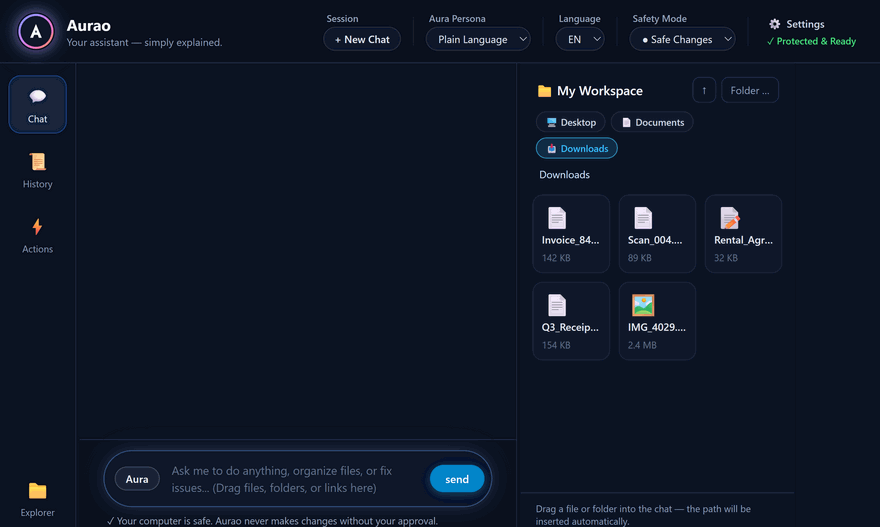

# Aurao — Your Friendly Desktop Assistant for Files, Research & Everyday Work

[](https://github.com/badnexus/Aurao/releases/latest)
[](https://github.com/badnexus/Aurao/stargazers)
[](https://badnexus.github.io/Aurao/)
[](LICENSE)
[](https://github.com/badnexus/Aurao/releases)
[](#)

> **The power of autonomous AI agents — without the command line.**  
> Aurao helps you organize messy folders, summarize piles of PDFs, conduct web research, and draft reports right on your desktop, with total safety and zero technical jargon.

<p align="center">
  
</p>

<p align="center">
  <a href="https://github.com/badnexus/Aurao/releases/latest/download/Aurao-0.3.1.exe">
    
  </a>
  &nbsp;
  <a href="https://badnexus.github.io/Aurao/">
    
  </a>
</p>
<p align="center"><em>No installer, no Node.js, no terminal commands. Just download <code>Aurao-0.3.1.exe</code> and run — or view <a href="https://github.com/badnexus/Aurao/releases">all releases</a>.</em></p>

---

## 💡 Why Aurao?

Modern AI agents can read files, write documents, and search the web. But until now, they were trapped inside **developer terminals** — black command-line windows full of cryptic errors, code syntax, and the constant fear of accidentally deleting something important.

**Aurao changes that.** It wraps cutting-edge autonomous AI engines (including the **OpenAI Codex CLI**, **Google Antigravity (`agy`)**, and Anthropic's **Claude Agent SDK**) into a calm, welcoming desktop application designed for everyday people.

> *"I originally built Aurao for my wife so she could harness the full power of autonomous agentic AI for research, document management, and everyday work—without touching a terminal or learning code. It worked so well that we realized millions of professionals, researchers, and creators face the exact same barrier."*

---

## ✨ What You Can Do in 5 Minutes

| Everyday Task | How Aurao Solves It |
| :--- | :--- |
| 📁 **Clean Messy Folders** | Drag your cluttered *Downloads* or *Desktop* folder into Aurao. Ask: *"Sort these files into folders by year and topic."* |
| 📑 **Summarize Stacks of Documents** | Drop 20 PDF reports or notes into the chat. Ask: *"Compare the key findings and write a 1-page executive summary."* |
| 🔍 **In-Depth Web Research** | Give Aurao a topic. It browses, verifies sources, and writes a complete briefing directly to your *Documents* folder. |
| ✍️ **Draft & Edit Without Copy-Pasting** | Unlike web chatbots where you constantly copy and paste text back and forth, Aurao directly creates and edits documents on your computer. |

---

## 🛡️ Complete Control: You Are Always in the Driver's Seat

Letting an AI touch your files can feel daunting. That is why Aurao was engineered around **Human-in-the-Loop Safety** from day one:

- 🟢 **Clear Approval Cards:** Aurao **never** modifies or deletes a file without showing you an easy-to-read card. You see exactly what is about to change, and you click **Approve** or **Decline**.
- 🚦 **Safety Modes Tailored to You:**
  - **● Safe Changes (Default):** Aurao reads documents and searches the web freely, but pauses and asks for your approval before saving or altering any file.
  - **● Always Ask:** Prompts you before every single action for maximum oversight.
  - **● Autonomous Mode:** For power users who want hands-free automated batch workflows.
- 🔒 **Your Files Stay on Your Computer:** Aurao runs locally on your desktop. Your local files are never uploaded to hidden third-party storage or public training datasets.

---

## ⚡ How Aurao Compares

| Feature | Standard Web Chat (ChatGPT/Claude.ai) | Developer CLI (Terminal Agents) | **Aurao Desktop** |
| :--- | :---: | :---: | :---: |
| **Works with Local Files & Folders** | ❌ (Manual upload only) | ✅ Yes | 🌟 **Yes (Drag & Drop)** |
| **No Coding or Terminal Knowledge** | ✅ Yes | ❌ (Requires CLI / Git) | 🌟 **Yes (Zero Jargon)** |
| **Visual One-Click File Approvals** | ❌ None | ❌ (Text prompts) | 🌟 **Interactive Cards** |
| **Portable & Zero-Install** | N/A (Web only) | ❌ Complex setup | 🌟 **Single .exe (USB-ready)** |
| **Direct Document Editing** | ❌ Copy-paste required | ✅ Yes | 🌟 **Native File Generation** |

---

## 🚀 Quick Start Guide (Windows)

1. **Download:** Grab [`Aurao-0.3.1.exe`](https://github.com/badnexus/Aurao/releases/latest/download/Aurao-0.3.1.exe) directly (or from the [Releases page](https://github.com/badnexus/Aurao/releases)).
2. **Launch:** Double-click the file. (No installation, Python, or administrator rights required!).
3. **Auto-Detect Ready:** On first launch, Aurao automatically detects whether you have **Claude Code (`claude`)**, **OpenAI Codex (`codex`)**, or **Google Antigravity (`agy`)** installed — or click the **Settings (`⚙️`)** icon in the top right to choose your engine and model.
4. **Get to Work:** Drag any document or folder into the window and start chatting!

*(Supports Windows 10 & 11. Power users can also install via Winget once indexed: `winget install badnexus.Aurao`. macOS and Linux builds run directly from source.)*

---

## ❓ Frequently Asked Questions (FAQ)

### What is Aurao?
Aurao is an open-source, user-friendly desktop application for Windows, macOS, and Linux that allows non-technical users to run autonomous AI agents. It provides a visual interface for complex file management, multi-document research, and desktop automation without requiring command-line skills.

### Do I need to be a programmer or know how to code?
**Not at all.** Aurao was specifically built for non-programmers. It features a Plain Language Persona that avoids technical jargon (no mentions of "APIs", "repositories", or "command lines") and replaces them with everyday desktop concepts like folders, files, and one-click approvals.

### Can Aurao accidentally delete my files?
**No.** By default, Aurao operates in "Safe Changes" mode. Whenever the assistant wants to create, edit, or delete a file, it presents a clear Approval Card explaining what will happen. The file is only modified after you click **Approve**.

### How does Aurao connect to AI models?
Aurao connects to leading autonomous agent frameworks, including the **OpenAI Codex CLI**, **Google Antigravity (`agy`)**, and Anthropic's **Claude Agent SDK**. You can connect it via your existing API key or local setup in the Settings dialog.

### Is Aurao free and open source?
Yes! Aurao is licensed under the GNU General Public License v3.0 (GPLv3). You are free to download, use, and share it.

---

## 👨‍💻 For Developers & Power Users

> **⭐ Why Developers Star & Share Aurao:**
> - **Clean Multi-Engine Abstraction (`IEngine.ts`):** Unified TypeScript interface wrapping `@anthropic-ai/claude-agent-sdk`, OpenAI's **`codex app-server`** (via persistent low-latency JSON-RPC 2.0 over `stdio` with direct Windows native Rust binary unwrapping), and Google's **Antigravity CLI (`agy`)**.
> - **Zero-Config CLI Auto-Detection (`cliDetect.ts`):** Pure filesystem binary detection (`PATH` + standard npm/user bin paths) that automatically selects the installed agent CLI on first launch without spawning visible console windows on Windows.
> - **Human-in-the-Loop Pre-Tool Hooks:** Intercepts mutating file/command tool calls across all 3 engines and routes them through context-isolated Electron IPC (`window.aurao`) to render interactive 1-click Approval Cards (`ask` | `safe` | `bypass`).
> - **Shareable with Non-Tech Family & Teammates:** The easiest way to hand Claude Code, Codex CLI, or Antigravity to a spouse, researcher, or business colleague as a single portable `.exe`.

<details>
<summary><strong>Click here to view Architecture, Source Build & Contributing instructions</strong></summary>

### Prerequisites
- [Node.js](https://nodejs.org/) v22+
- Either the **OpenAI Codex CLI**, **Google Antigravity CLI (`agy`)**, or Anthropic API credentials configured.

### Building from Source
```bash
# 1. Clone repository
git clone https://github.com/badnexus/Aurao.git
cd Aurao

# 2. Install dependencies
npm install

# 3. Run development mode
npm start

# 4. Package standalone Windows Portable & Setup executables
npm run dist
```

Built executables and SHA-256 verification hashes are written to the `release/` directory.

### Architecture Overview
Aurao is built with Electron and TypeScript using a clean separation of concerns:
- `src/main/IEngine.ts` — Common engine interface abstraction.
- `src/main/GptsEngine.ts` — OpenAI Codex CLI app-server subprocess orchestration.
- `src/main/AgyEngine.ts` — Google Antigravity CLI subprocess orchestration, dynamic model discovery, and hook bridges.
- `src/main/ClaudeEngine.ts` — Claude Agent SDK integration and lifecycle management.
- `src/main/files.ts` — Clean file system navigation with hidden dotfile filtering and quick jump directories.
- `src/main/sessions.ts` — Native session querying and transcript history reconstruction.
- `src/main/persona.ts` — Plain-language desktop persona prompts.
- `src/preload/preload.ts` — Secure context-isolated IPC bridge (`window.aurao` with `window.termi` alias).
- `src/renderer/` — Reactive UI, glowing aura components, Markdown parsing, and approval cards.

### Engine profiles

`config.json` can ship named environment sets for the engine process — for example two cloud resources,
a region, or a base URL. The user picks one in Settings (and in the top bar when there are several); the
choice is remembered per user, the profiles themselves always come from the bundled config. The chosen
profile is applied after the system environment; `null` removes a variable. Values never reach the UI or
the logs, only the variable names.

```json
"engineProfile": "Cloud A",
"engineProfiles": {
  "Cloud A": { "MY_PROVIDER_RESOURCE": "resource-a", "MY_PROVIDER_REGION": "eu-west-1" },
  "Cloud B": { "MY_PROVIDER_RESOURCE": "resource-b", "MY_PROVIDER_REGION": null }
}
```

### Home-relative paths in config.json

`workspaceRepo`, `workspaceRoot` and `claudeExecutable` may start with `~/`, meaning the user's home
folder — so one shipped `config.json` fits every user, for example `"workspaceRepo": "~/MyAssistant"`
together with `workspaceGitUrl`.

</details>

---

## Code Signing & Privacy Policy

- **License:** Aurao is free and open-source software distributed under the **GNU General Public License v3.0 (GPL-3.0-only)**. See [LICENSE](LICENSE) for full details.
- **Code Signing:** Free code signing on Windows is provided by [SignPath.io](https://signpath.io/), certificate by [SignPath Foundation](https://signpath.org/).
  - **Committers & Reviewers:** [Florian Schaider (@badnexus)](https://github.com/badnexus)
- **Privacy Policy:** This program will not transfer any information to other networked systems unless specifically requested by the user or the person installing or operating it (such as sending prompts to the user's configured AI engine provider or syncing a user-configured Git workspace).

---

<p align="center">Made with ❤️ for everyone who wants AI that gets real work done.</p>
