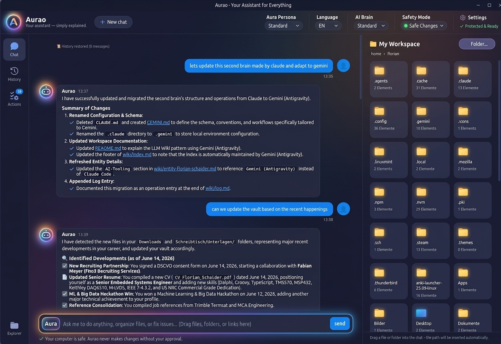

# Aurao — Your Assistant for Everything

[](LICENSE)
[](https://www.electronjs.org/)
[](https://www.typescriptlang.org/)
[]()



**Aurao** is a safe, friendly desktop assistant for files, research, and everyday workflows. It brings the full power of autonomous agent frameworks—including the **Google Antigravity CLI (`agy`)** and the **Anthropic Claude Agent SDK**—to non-technical professionals, knowledge workers, and everyday users.

> *"I originally built Aurao for my wife so she could harness the full power of autonomous agentic AI for research, document management, and workflows—without having to learn terminal commands, Git, or shell syntax. It worked so well that I realized millions of non-technical professionals, researchers, and creators face the exact same barrier."*

---

## 🚀 Quick Start (Windows Portable)

No installation, Node.js, or command line required:

👉 **[Download the latest Aurao Windows Portable (.exe)](https://github.com/badnexus/Aurao/releases)**

1. Download `Aurao-vX.Y.Z.exe` from the latest GitHub Release.
2. Run the executable anywhere (USB drive, Desktop, Downloads).
3. Start chatting immediately, organize your folders, or summarize documents.
4. Click the **Settings (`⚙️`)** icon in the top right to verify system readiness or configure custom models.

---

## 🌟 Why Aurao?

Autonomous AI CLI tools can edit files, run commands, analyze folders, and search the web. However, raw terminal prompts are intimidating, verbose, and risky without visual guardrails.

Aurao reimagines agentic AI as a warm, human-centered companion:

- 🎨 **Warm & Welcoming Design:** Soft glowing aura branding and zero technical jargon. Switch between a standard mode and a **Plain Language Persona** that replaces developer concepts (*repositories, APIs, YAML, CWD*) with familiar desktop terms (*folders, documents, files*).
- 🛡️ **Zero-Risk Human-in-the-Loop Safety:**
  - **● Safe Changes (`safe`, default):** Reading documents and web search happen smoothly; any file modification or script execution requires your explicit approval via interactive cards.
  - **● Always Ask (`ask`):** Prompts for approval before every single action.
  - **● Without Approval (`bypass`):** Full autonomous mode with an unmistakable safety banner.
- 📁 **My Workspace with Clean View:**
  - Quick-access jump buttons for **🖥️ Desktop**, **📄 Documents**, and **📥 Downloads**.
  - System dotfiles (`.config`, `.cache`, `.git`) are hidden by default, keeping your folders clean and distraction-free.
  - Drag and drop any document or folder into the chat to immediately discuss or process it.
- 🧠 **Second Brain & Knowledge Work Integration:** Effortlessly summarize folders of PDFs, sort messy downloads into categories, and update personal research notes (Obsidian / Markdown vaults).
- ⚡ **Transparent Actions View:** Replaces raw developer terminals with a clear, readable activity log so you can always see what Aurao did behind the scenes.
- 📜 **Chat History & Session Resuming:** Revisit past conversations anytime via the **Verlauf (History)** tab with full Markdown formatting and quick keyword search.
- ⚙️ **Dynamically Rebrandable & Extensible:** Prefer a custom name like "Bob" or "Jarvis"? Customize the assistant name, persona, models, and approval rules directly in `config.json` or the Settings dialog.
- 🌐 **Bilingual (DE / EN):** Complete native localization in German and English.

---

## 🛠️ Building & Running from Source

If you want to run from source or contribute:

### Prerequisites
- [Node.js](https://nodejs.org/) v22+
- Either the **Google Antigravity CLI (`agy`)** or Anthropic API credentials configured.

### Quick Commands

```bash
# 1. Clone the repository
git clone https://github.com/badnexus/Aurao.git
cd Aurao

# 2. Install dependencies
npm install

# 3. Run in development mode
npm start

# 4. Package standalone Windows Portable executable
npm run dist
```

Built executables and SHA-256 verification hashes are written to the `release/` directory.

---

## 🏗️ Architecture

Aurao is built with Electron and TypeScript using a clean separation of concerns:

- `src/main/IEngine.ts` — Common engine interface abstraction.
- `src/main/AgyEngine.ts` — Google Antigravity CLI subprocess orchestration, dynamic model discovery, and hook bridges.
- `src/main/ClaudeEngine.ts` — Claude Agent SDK integration and lifecycle management.
- `src/main/files.ts` — Clean file system navigation with hidden dotfile filtering and quick jump directories.
- `src/main/sessions.ts` — Native session querying and transcript history reconstruction.
- `src/main/persona.ts` — Plain-language desktop persona prompts.
- `src/preload/preload.ts` — Secure context-isolated IPC bridge (`window.aurao` with `window.termi` alias).
- `src/renderer/` — Reactive UI, glowing aura components, Markdown parsing, and approval cards.

---

## ⚖️ License & Dual-Licensing

Aurao is free open-source software, licensed under the **GNU General Public License v3.0 (GPLv3)**.

- **Community & Personal Use:** You are free to run, study, share, and modify Aurao under the terms of the GPLv3. Any distributed modifications must also remain open source under the GPLv3.
- **Contributions:** We welcome community contributions! Contributing requires accepting our lightweight [Contributor License Agreement (CLA)](CLA.md).
- **Commercial & Enterprise Licensing:** If you or your organization wish to integrate or distribute Aurao without the copyleft obligations of the GPLv3 (e.g., in a proprietary corporate deployment or embedded within a closed-source solution), commercial licenses are available. Please contact Florian Schaider to discuss options.
